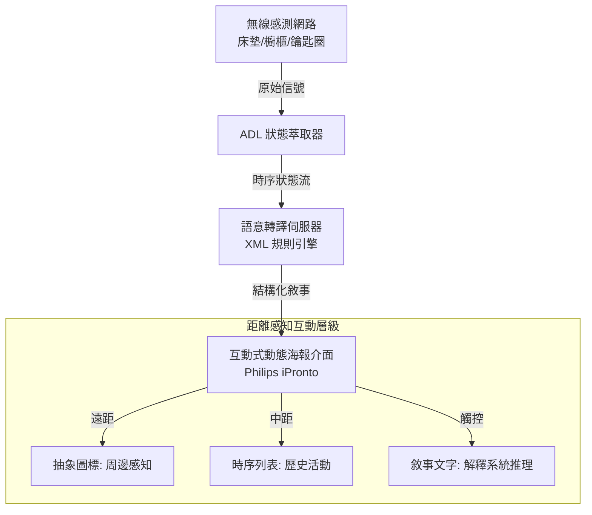

# Daily Activities Diarist: Supporting Aging in Place with semantically enriched narratives (日常生活日記：以語意豐富的敘事支持在地安老)

## 📌 TL;DR
本研究提出「Daily Activities Diarist」居家環境感知系統，透過無線感測器網路收集長者的日常生活活動（ADL），並創新地將生硬的感測數據轉化為「語意豐富的敘事日記（Narrative Journal）」，藉由多層次的周邊感知顯示介面，在不破壞隱私與不產生「被查勤感」的前提下，維持獨居長者與遠方成年子女間的情感聯繫。

---

## 🎯 欲解決的使用者痛點與動機 (Motivation & User Need)
* **既有互動痛點**：
  * **長者端的心理負擔**：獨居長者害怕頻繁聯繫會打擾子女的工作與生活；同時，面對子女每天的電話問候，長者容易感到「被監控、被查勤（checked up on）」，產生自尊受挫。
  * **子女端的焦慮與盲點**：遠方成年子女（Intimate Socials）極度渴望了解長者健康狀況（如睡眠、用餐、是否出門），但現有感知系統（如單純的感測次數圖表）容易因感測器雜訊或缺訊引發誤判與不必要的恐慌。
* **研究核心動機**：
  * 探索如何透過「敘事化語言（Narrative Presentation）」而非冰冷的圖表，來傳遞長者的生活狀態，並在介面設計上融入「縫隙設計（Seamful Design）」來呈現技術的不確定性。

---

## 🖥️ 互動系統與核心機制 (System & Interaction Technique)

### 1. 系統架構與感知層
* **感知採集**：在長者家中安裝 Crossbow MICA2 / MICA2dot 感測模組，包含櫥櫃光感測器（偵測開關門與用餐活動）、床墊壓力墊（偵測就寢與睡眠中斷）、鑰匙圈加速度計（偵測離家與戶外活動程度）。
* **語意轉譯引擎**：將底層感測信號抽象為 ADL 狀態，透過 XML 規則轉換為自然語言敘事（例如：若在床上少於 3 小時標記為「小睡 (nap)」，中斷超過 3 次標記為「睡眠稍有不安 (disrupted sleep)」）。

### 2. 多層次互動介面（以距離作為互動維度 Distance as Interaction）
系統顯示端部署於成年子女家中（採用 Philips iPronto 觸控螢幕）：
* **遠距離（周邊感知層 Peripheral Awareness）**：使用者在遠處時，螢幕僅顯示簡約的房子狀態圖標（如「在床上」、「在廚房」、「外出中」），提供不干擾日常生活的輕量感知。
* **中距離（時序歷史層 Historical List）**：走近螢幕時，右側展開當天的時間軸活動清單。
* **近距離（敘事推理層 Explanatory Narrative）**：當使用者親手觸控點擊時，展開詳細的系統敘事推理文字（例如：「昨晚 23:30 爸爸上床，睡眠略有中斷，今早 07:45 起床。系統於 01:45 與 04:30 偵測到兩次動靜」）。

---

## 👥 使用者研究與評測 (User Study & Evaluation)
* **研究設計**：
  * 2 組真實家庭（各包含 1 位獨居長者與其成年子女家庭），在荷蘭進行為期兩週的實地場域部署測試（Field Trials）。
  * 採用標準化 ABC 量表衡量社交聯繫感（Social Connectedness），並結合前後訪談。
* **關鍵發現與回饋**：
  * **日常依賴建立迅速**：子女端在熟悉系統後，養成在出門上班前或起床後查看日記的習慣，用以判斷「此時適不適合打電話給父母」。
  * **非預期的心理療效**：兩位長者的廣場恐懼感（Agoraphobia）顯著降低，變得更願意出門散步，因為他們知道「子女隨時能感知到自己是安全的」。
  * **硬體故障帶來的焦慮**：在第二組測試中，因感測器電池耗盡與斷線產生系統故障（誤報長者半夜外出），導致子女整夜未眠且陷入高度恐慌。

---

## 💡 設計啟發與指引 (Design Implications & Guidelines)

1. **落實縫隙設計 (Embrace Seamful Design)**：
   * 環境感知系統不可避免會面臨網路斷線或感測器失效。系統不應假裝完美，而應在敘事中主動傳達可信度與不確定性（例如使用「爸爸『可能』在睡覺」，並允許使用者點擊查看感測器連線與電量健康度）。
2. **敘事化溝通優於數值視覺化 (Narrative over Raw Visualization)**：
   * 數值化圖表（如開門次數、活動熱度）需要使用者自行推理，容易造成過度解讀；具有語意上下文的自然語言敘事更能有效傳達「生活節奏」並消除誤會。
3. **保持單向感知的平衡與邊界**：
   * 長者對子女知悉其日常持開放態度（「這是我的孩子，沒什麼隱私問題」），反倒是子女端時常產生「自己在刺探父母隱私」的內疚感；系統需提供雙向可控的開關機制。

---

## 🔗 關聯概念與論文 (Related Concepts & Papers)
* **核心概念**：[[seamful-design|縫隙設計 (Seamful Design)]], [[peripheral-awareness|周邊感知系統 (Peripheral Awareness)]]
* **直接關聯論文**：[[2018-jmir-elers-userrequirementsaginginplace|Elers et al., 2018 - 在地安老科技之使用者需求]]
