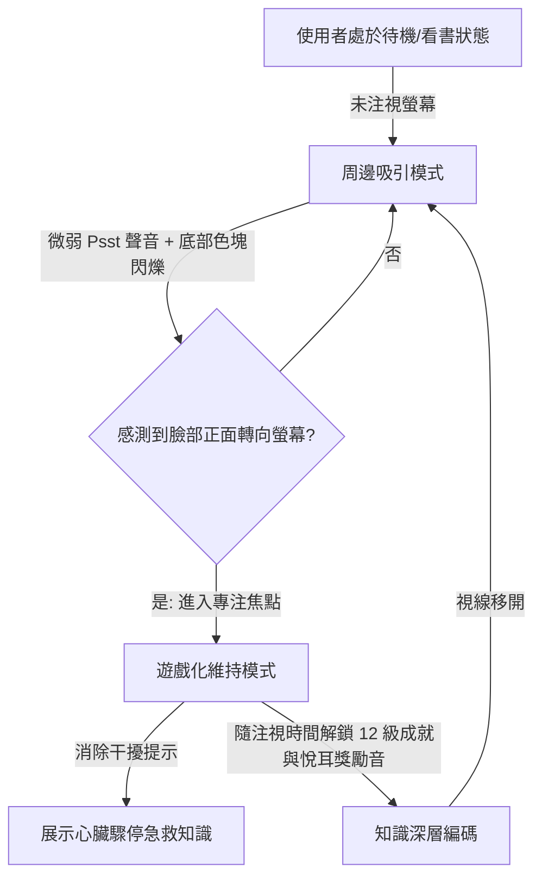

# Lead me gently: Facilitating knowledge gain through attention-aware ambient learning displays (溫柔引導：透過注意力感知環境學習顯示器促進知識獲取)

## 📌 TL;DR
本研究針對環境顯示器（Ambient Displays）在學習情境中「過於安靜易被忽略、過於主動又具干擾性」的兩難困境，設計了一套結合人臉辨識感測與遊戲化機制的「注意力感知顯示器」。在 52 名受試者的真實候診室模擬實驗中證實，注意力感知設計能使使用者提早近一倍的時間注意到資訊，並使總專注時間增加一倍以上，顯著提升了急救知識的獲取成效，但同時也凸顯了注意力引導與干擾感（Disruptiveness）之間的精密權衡。

---

## 🎯 欲解決的使用者痛點與動機 (Motivation & User Need)
* **環境顯示器應用於學習的核心矛盾**：
  * 寧靜科技（Calm Technology）追求將資訊置於周邊（Periphery）而不打擾使用者；然而**「學習」本質上需要使用者將注意力轉移至焦點（Focus of Attention）**並投入工作記憶。
  * 過去的研究要麼過於平靜導致使用者完全忽視顯示器，要麼過於喧鬧造成嚴重干擾。
* **研究核心動機**：
  * 探討能否透過「感知使用者注意力狀態並進行動態自適應引導」的機制，在維持環境融入感的同時，最大化知識傳遞效果。

---

## 🖥️ 互動系統與核心機制 (System & Interaction Technique)

### 1. 感知與自適應互動架構
* **客製化注意力感測器**：使用 27 吋螢幕搭配網路攝影機，透過 Processing 與 OpenCV 進行正面人臉辨識，即時計算使用者是否正視螢幕。
* **周邊吸引階段 (Attract Attention)**：
  * 當感測到使用者未注視螢幕時，每隔 12.5 秒發出柔和的人聲語音提示（「Psst!」），並在簡報下方疊加微弱閃爍的彩色提示框。
* **焦點維持階段 (Retain Attention via Gamification)**：
  * 一旦使用者轉頭注視螢幕，聲音與閃爍立即消失；轉而啟動**12 級遊戲化成就解鎖機制**：隨著凝視時間累積，螢幕底部依指數函數點亮成就色塊，並伴隨和諧的 3 音階獎勵音效。

---

## 👥 使用者實驗與評測 (Evaluation & Findings)
* **受試者與情境**：
  * $N=52$ 位大學職員（隨機分配至實驗組 26 人、對照組 26 人，排除醫療專業背景）。
  * 實驗場域還原真實候診室（擺設桌椅、盆栽、書報），受試者被要求在等待期間填寫問卷（作為主要任務 Primary Task）。
* **量化成果**：
  * **注意力捕獲速度**：實驗組平均在第 155 秒即被吸引至焦點，對照組則遲至第 289 秒才注意到螢幕（$p = .001$）。
  * **專注總時長**：實驗組平均專注時間達 709 秒，是對照組（295 秒）的 2.4 倍（$p = .002$）。
  * **知識獲取成效**：急救知識測驗成績顯示，注意力投入度與測驗得分呈現顯著正相關（$r = .54, p < .001$），且在控制先備知識後，實驗組得分顯著優於對照組（$p = .041$）。
* **干擾性代價 (Disruptiveness)**：
  * 實驗組對螢幕干擾感評分顯著高於對照組（$M = 3.08$ vs. $1.50, p < .001$），證明語音與視覺刺激在換取注意力的同時，確實對主要任務產生了打擾。

---

## 💡 HCI 設計啟發與指引 (Design Implications & Guidelines)

1. **「溫柔引導」漸進過渡 (Lead Me Gently)**：
   * 從周邊過渡到焦點的通知必須具備動態漸進性（Gradual Transitions），不能使用突兀或驚嚇式的警報，否則會破壞使用者對空間的舒適感。
2. **正向遊戲化能有效延長非強制性專注**：
   * 即時的回饋機制（如隨注視時間增長的微視覺回饋）能給予使用者「行動可預測性」與「成就進展」，有助於在非強制環境下延長停留時間。
3. **任務情境與干擾預算 (Interruption Budget)**：
   * 設計環境學習介面時，必須評估環境中的主要任務價值。若主要任務重要性極高（如辦公專注），干擾頻率必須大幅壓低；若處於被動等待情境（如候車室、候診區），則可適度提升通知強度。

---

## 🔗 關聯概念與論文 (Related Concepts & Papers)
* **核心概念**：[[attention-aware-displays|注意力感知顯示與干擾性權衡 (Attention-Aware Displays)]], [[peripheral-awareness|周邊感知系統 (Peripheral Awareness)]]
* **直接關聯論文**：[[2008-ami-metaxas-dailyactivitiesdiarist|Metaxas et al., 2008 - 日常生活日記]]
