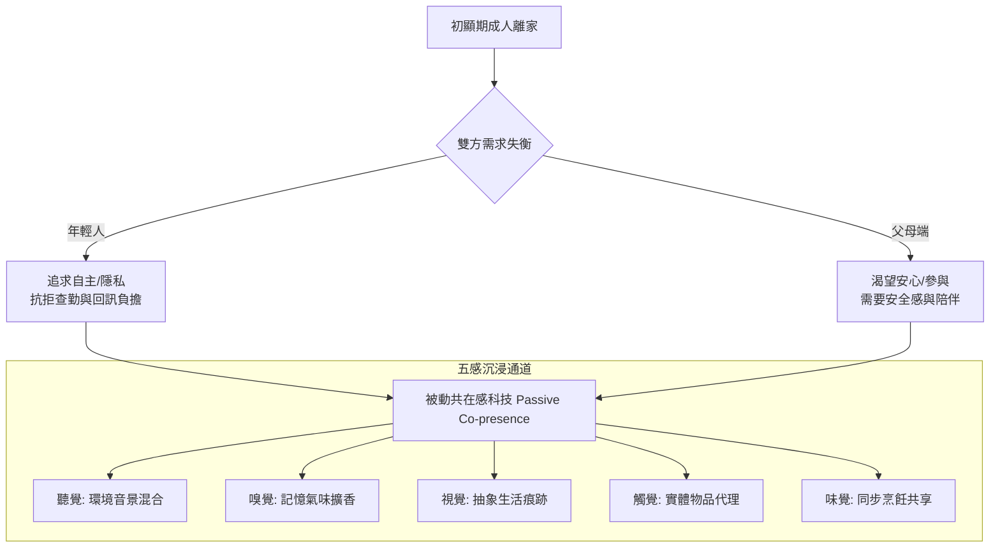

# Sensing Their Presence: How Emerging Adults And Their Parents Connect After Moving Apart (感知彼此的存在：初顯期成人與其父母在分居後如何建立連結)

## 📌 TL;DR
本研究針對初顯期成人（18～27 歲年輕人）搬離原生家庭後的代際溝通痛點，透過與 16 對親子（共 32 人）的深度協同設計（Co-design）研究，首創性地從「五感（視覺、聽覺、嗅覺、觸覺、味覺）」視角剖析「被動共在感（Passive Co-presence）」，提出如何在尊重年輕人獨立隱私與化解父母擔憂之間取得平衡的多感官居家科技設計原則。

---

## 🎯 欲解決的使用者痛點與動機 (Motivation & User Need)
* **代際轉折期的需求衝突**：
  * **初顯期成人的心理壓力**：剛離家獨立生活，強烈渴望維護自主權與個人空間隱私；對於父母頻繁的關切訊息感到資訊超載（Overwhelmed），並常因無法及時回覆產生沉重的愧疚感。
  * **父母端的擔憂與失落**：習慣了過去天天同住的生活，面對子女離家產生「空巢失落」與對其安好的焦慮，渴望確認子女安全並透過分享日常參與子女的新生活（Living vicariously）。
* **現有溝通工具的局限**：
  * 即時通訊與常開型視訊（Always-on video）需要高度同步心力與時間協調，且極易侵犯年輕人與合租室友的隱私；過去科技嚴重缺乏「如同在同一個屋簷下、不講話也能感知彼此存在」的被動連結手段。

---

## 🖥️ 五感視角下的被動共在感設計 (Multisensory Co-Design Insights)

研究透過 5 天居家活動與 8 場推測性設計工作坊，梳理五種感官在建立被動共在感的獨特價值與限制：

* **👂 聽覺 (Sound)**：
  * 家中環境聲音（如廚房做飯聲、敲鍵盤聲、腳步聲）是年輕人離家後最懷念的背景幕；參與者提出「共享音景（Shared Soundscapes）」構想，例如散步時混合兩地的風聲與鳥鳴，創造無須言語的虛擬共處。
* **👁️ 視覺 (Sight)**：
  * 遺留的「生活痕跡（Traces）」（如留在家中的舊家具、未關緊的櫥櫃門）能觸發溫暖連結；反對未經抽象化的即時視訊監控。
* **👃 嗅覺 (Smell)**：
  * **最熱烈且最具情感穿透力的感官**。「氣味景觀（Smellscapes）」（如媽媽烤餅乾的香氣、特定洗髮精味道）具有強大的回憶召喚力；設計提出「氣味感測夾與擴香儀」遠距傳遞家的味道。
* **🖐️ 觸覺 (Touch)**：
  * 透過「代理觸摸（Touch-by-proxy）」（如撫摸父母寄來的毯子、抱著特製泰迪熊）尋求撫慰，並提出需要明確知情同意（Explicit Consent）的遠距撫慰觸覺衣構想。
* **👅 味覺 (Taste)**：
  * 圍繞食物的家庭日常是親情的錨點；透過遠端共享家庭食譜、甚至「遠距同步廚房鏡像（Co-cooking）」重溫與父母一起做飯的時光。

---

## 👥 使用者研究方法論 (Methodology & Participants)
* **研究規模**：$N=32$（16 對親子配對，包含 16 位 18～27 歲青年與 16 位 39～64 歲父母）。
* **四階段協同設計流程**：
  1. **個別會前訪談**（避免親子間權力動態干擾，深入了解各自隱私觀點）。
  2. **5 天五感居家反思活動**（產出 345 則文字、110 張照片、19 段音訊）。
  3. **8 場分組設計工作坊**（父母組與青年組分開進行推測性設計腦力激盪）。
  4. **親子配對會後共同訪談**（將彼此生成的設計方案交叉檢驗，探討衝突與妥協）。

---

## 💡 HCI 設計啟發與指引 (Design Implications & Guidelines)

1. **嚴守合租與私人空間的隱私界線 (Non-invasive & Localized)**：
   * 年輕人多與室友同住，系統**絕不可在客廳、走道等共享公共空間收集感測數據**，感測範圍必須嚴格局限於個人私密臥室，且避免在公共區域暴露父母端傳來的資訊。
2. **多感官環境氛圍的「音樂混音」隱喻 (Musical Mashups Metaphor)**：
   * 共享環境氛圍不代表同步直播。設計可將來自不同時間、不同來源的感測線索（如微弱的廚房聲音搭配間歇性香氣）如同音樂混音般層疊，營造整體空間的「溫馨在場感」，避免洩露敏感日常細節。
3. **支援懷舊感與意外驚喜 (Nostalgia & Serendipity)**：
   * 善用生活中的「遺留物（Left-behinds）與紀念品」作為實體代理介面（Tangible Proxies），並加入偶發性的微小感官驚喜，喚醒共同記憶，而非施加例行公事的互動義務。

---

## 🔗 關聯概念與論文 (Related Concepts & Papers)
* **核心概念**：[[passive-co-presence|被動共在感 (Passive Co-Presence)]], [[peripheral-awareness|周邊感知系統 (Peripheral Awareness)]], [[informal-support-networks|非正式支持網絡 (Informal Support Networks)]]
* **直接關聯論文**：[[2008-ami-metaxas-dailyactivitiesdiarist|Metaxas et al., 2008 - 日常生活日記]]
