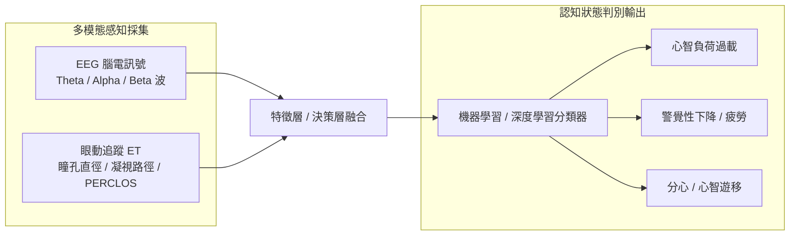

# Combining EEG and eye-tracking for cognitive and physiological states monitoring (結合腦電圖與眼動追蹤進行認知與生理狀態監測)

## 📌 TL;DR
本系統性文獻回顧彙整了 47 項結合腦電圖（EEG）與眼動追蹤（ET）的實證研究，全面分析如何透過多模態生理訊號即時監測心智負荷（Mental Workload）、疲勞、壓力、嗜睡（Drowsiness）及心智遊移（Mind Wandering）。研究證實，多模態特徵融合（Multimodal Fusion）能顯著降低單一感測器的盲點，大幅提升高危險人機系統中的情境覺知（Situational Awareness）判斷精準度。

---

## 🎯 欲解決的使用者痛點與動機 (Motivation & User Need)
* **高危險操作環境的感知衰退問題**：
  * 在航空飛行、車輛駕駛、軍事任務與手術等高認知負荷情境中，操作者的專注力與警覺性（Vigilance）下降是引發嚴重人為錯誤的核心主因。
  * **狀態重疊與難以區分**：工作負荷、壓力與疲勞在生理指標上高度重疊交織，單一感測器（如僅用 EEG 或僅用 ET）難以精準區分相近的認知退化狀態。
* **研究核心動機**：
  * 探討神經電生理訊號（大腦動態）與眼動行為特徵（視覺注意力）如何互補，並評估多模態機器學習分類器相較於單模態系統的優勢。

---

## 🖥️ 核心生理指標與多模態機制 (System & Interaction Technique)

### 1. 關鍵 EEG 與眼動特徵映射
* **腦電圖 (EEG) 特徵**：
  * **Theta 波 (4–8 Hz) 與 Beta 波 (12–30 Hz)**：心智負荷增加與壓力狀態下普遍上升，反映執行功能投入與認知焦慮。
  * **Alpha 波 (8–12 Hz)**：專注力下降、疲勞與微睡眠（Microsleep）前後顯著波動。
  * **指標比值**：$\theta/\alpha$ 及 Engagement Index $\beta/(\theta+\alpha)$ 能有效評估注意力投入度。
* **眼動追蹤 (ET) 特徵**：
  * **凝視頻率與瞳孔直徑 (Pupil Diameter)**：心智負荷增加時瞳孔顯著放大，而長期疲勞則導致瞳孔縮小與反應遲鈍。
  * **閉眼百分比 (PERCLOS)**：當 PERCLOS 超過 80% 時，是偵測微睡眠與深度嗜睡的關鍵黃金指標。
  * **掃視模式與凝視熵 (Gaze Entropy)**：壓力與疲勞會使視線熱區呈現發散（Dispersion），但受過嚴格訓練的專家（如戰鬥機飛行員）其掃描路徑具備高度規律性與抗疲勞穩定性。

---

## 👥 實證回顧成果與分類成效 (Evaluation & Findings)
* **樣本與範疇**：
  * 依據 PRISMA 規範自 581 篇文獻中嚴選 47 篇實證論文，涵蓋模擬駕駛、空管（ATC）、外科手術與飛行模擬任務。
* **分類模型成效（Multimodal vs. Single-Sensor）**：
  * 在心智負荷、疲勞與心智遊移的分類任務中，**多模態融合（EEG+ET）在 80% 以上的研究中準確率顯著優於單一模態**（例如在多篇駕駛與軍事實驗中，融合模型準確率達 88%～97%，高於單獨 ET 的 75% 與單獨 EEG 的 83%）。
  * 眼動儀擅長捕捉「外部視覺注意力的轉移」，而 EEG 擅長捕捉「大腦內部認知資源耗竭」，兩者具備極強的互補性。

---

## 💡 HCI 設計啟發與人機協同深思 (Design Implications)

1. **次世代自適應人機介面 (Adaptive BCI / Ergonomic UI)**：
   * 未來智慧座艙或複雜工作台介面可利用即時多模態生理監測，動態調節介面複雜度：當偵測到操作員進入「高負荷+疲勞」臨界點時，系統自動簡化儀表視覺資訊或接管次要任務。
2. **閉環干預與輕量化要求**：
   * 即時監測系統必須在滑動時間窗口（Sliding Windows）內完成無雜訊特徵提取，並結合個體專屬校準（Subject-specific calibration），避免模型在不同使用者間泛化能力低落。

---

## 🔗 關聯概念與論文 (Related Concepts & Papers)
* **核心概念**：[[multimodal-cognitive-monitoring|多模態認知狀態監測 (Multimodal Cognitive Monitoring)]], [[peripheral-awareness|周邊感知系統 (Peripheral Awareness)]]
* **直接關聯論文**：[[2014-compedu-borner-attentionawareambientdisplays|Börner et al., 2014 - 注意力感知環境學習顯示器]]
